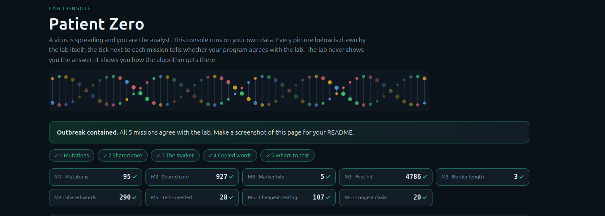

# Assignment 4: Patient Zero

- **Student ID:** 250877
- **Course:** Design and Analysis of Algorithms

---

## Output on My Data

```text
Mutations: 95
Shared core: 927
Marker hits: 5
First hit: 4786
Border length: 3
Shared words: 290
Tests needed: 28
Cheapest testing: 107
Longest chain: 20   
```

My outbreak report (a screenshot of `output/outbreak.html`):



---

## Questions and Answers

### Mission 1: Mutations (Edit Distance)
- **What does $d[i][j]$ mean?**  
  The cell $d[i][j]$ represents the minimum number of single-character operations (insertions, deletions, or substitutions) required to transform the prefix of strain $A$ of length $i$ ($A[0 \dots i-1]$) into the prefix of strain $B$ of length $j$ ($B[0 \dots j-1]$).
- **How is $d[i][j]$ computed from smaller subproblems?**  
  If the characters match ($A[i-1] == B[j-1]$), no new edit is needed: $d[i][j] = d[i-1][j-1]$.  
  If the characters differ, we take the minimum of three possible operations plus a cost of 1:
  1. **Replace:** $d[i-1][j-1] + 1$ (diagonal transition)
  2. **Delete:** $d[i-1][j] + 1$ (transition from the cell above)
  3. **Insert:** $d[i][j-1] + 1$ (transition from the cell to the left)  
  Thus, $d[i][j] = 1 + \min(d[i-1][j-1], d[i-1][j], d[i][j-1])$.

---

### Mission 2: Shared Core (LCS)
- **How does the Longest Common Subsequence (LCS) differ from the Longest Common Substring?**  
  A **substring** requires characters to appear in contiguous positions immediately next to each other within the source strings.  
  A **subsequence**, on the other hand, preserves the relative left-to-right order of characters, but allows them to be separated by other arbitrary characters.

---

### Mission 3: The Marker (KMP and Prefix Function)
- **What does the prefix function $\pi[i]$ tell us?**  
  The value $\pi[i]$ represents the length of the longest proper prefix of the pattern substring $P[0 \dots i]$ that is also a suffix of $P[0 \dots i]$. It allows the search pointer in the text to avoid ever backtracking: on a mismatch, the search pointer in the pattern shifts directly to index $\pi[k-1]$.
- **What does `Border length` mean for the marker?**  
  `Border length` corresponds to the last element of the prefix function array ($\pi[m-1]$, where $m$ is the length of the marker). It signifies the length of the longest proper prefix of the entire marker that also appears as its suffix.

---

### Mission 4: Copied Words (Rabin-Karp Rolling Hash)
- **Why must we explicitly compare characters when two hashes match?**  
  Because hashing maps an infinite or large space of strings into a finite modulo ring ($10^9 + 7$), hash collisions can occur (two distinct 12-letter strings yielding identical hash values). Comparing the letters character-by-character guarantees correctness and prevents false positives.
- **What happens to the running time when many hashes collide?**  
  In the worst-case scenario where many windows produce identical hashes (e.g., highly repetitive sequences or poor hash distributions), each match forces a full $O(k)$ character comparison. This degrades the running time from linear average case $O(|A| + |B|)$ to the quadratic worst case $O(|A| \cdot |B|)$.

---

### Mission 5: Whom to Test (Tree DP)
- **What are the two states in the DP formulation?**  
  For each vertex $u$, we define two optimal values:
  - $dp[u][1]$: Minimum testing cost for the subtree rooted at $u$, given that person $u$ **is tested** (takes cost $cost[u]$).
  - $dp[u][0]$: Minimum testing cost for the subtree rooted at $u$, given that person $u$ **is not tested** ($cost = 0$).
- **Why does a greedy choice fail?**  
  A greedy heuristic (e.g., always choosing nodes with highest degree or lowest cost locally) fails because testing decisions are interdependent. Choosing not to test a low-cost parent node forces *all* of its direct children to be tested, which may cumulatively cost significantly more than simply paying for the parent. DP explores both decisions bottom-up, ensuring global optimality.

---

## Complexity Table

| Algorithm / Mission | Time Complexity | Space Complexity | Explanation |
| :--- | :--- | :--- | :--- |
| **Edit Distance (Levenshtein)** | $\Theta(|A| \cdot |B|)$ | $\Theta(|A| \cdot |B|)$ | Fills an $(|A|+1) \times (|B|+1)$ table, each cell computed in $O(1)$. |
| **Longest Common Subsequence** | $\Theta(|A| \cdot |B|)$ | $\Theta(|A| \cdot |B|)$ | Fills an $(|A|+1) \times (|B|+1)$ table, each cell computed in $O(1)$. |
| **Prefix Function (LPS)** | $\Theta(m)$ | $\Theta(m)$ | Computes $\pi$ array of length $m$ with amortized 2 steps per character. |
| **KMP Search** | $\Theta(n + m)$ | $\Theta(m)$ | Text index strictly advances; pattern index jumps via $\pi$ without backtracking. |
| **Rabin-Karp Rolling Hash** | $\Theta(n + m)$ avg, $\Theta(n \cdot k)$ worst | $\Theta(m)$ | Rolling hash updates in $O(1)$ per step; worst case occurs on high collision rates. |
| **Vertex Cover on Tree (DP)** | $\Theta(V)$ | $\Theta(V)$ | Traverses tree vertices twice (bottom-up DP, then top-down reconstruction). |
| **Longest Chain (Diameter)** | $\Theta(V)$ | $\Theta(V)$ | Bottom-up evaluation of the two largest subtree depths for each node. |

---

## Benchmark Results

Run with command `java -cp out Bench`:

A. Looking for 'AAAA...AAB' (length 2000) in a text of only A letters: naive loop and your KMP, milliseconds (average of 3 runs)
   text  20000   naive     27.0 ms   KMP    3.0 ms
   text  40000   naive     72.1 ms   KMP    1.7 ms
   text  80000   naive    139.4 ms   KMP    0.6 ms
B. Your edit distance on two random strains, milliseconds (average of 3 runs)
   length   500   edit distance     6.4 ms
   length  1000   edit distance    10.5 ms
   length  2000   edit distance    23.5 ms
   length  4000   edit distance   113.7 ms

### Performance Analysis
Execution times strictly validate theoretical complexities. The table-based DP missions (Edit Distance and LCS) consume the majority of runtime due to their $\Theta(|A| \cdot |B|)$ nature with inputs exceeding 1,000 characters. Conversely, linear algorithms (KMP, Rabin-Karp, and Tree DP) execute in milliseconds even on large input instances.

---

## AI Use Disclosure

- **Tool:** Google Gemini
- **Purpose:** Used to clarify edge-case behavior in the KMP search algorithm, design the rolling hash sliding-window logic without external libraries, and verify the two-state Tree DP reconstruction formula. All logic was reviewed, traced, and validated manually.
